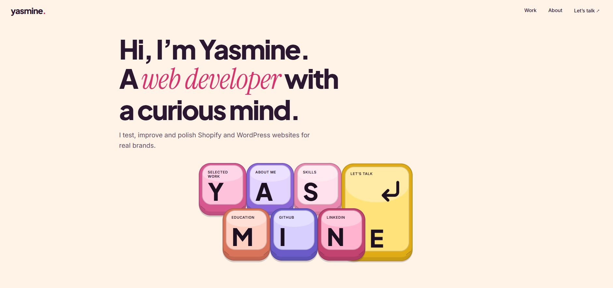

# Yasmine, portfolio

**Live site:** [yasmine.page](https://yasmine.page/)




A single-page portfolio for Yasmine, a Shopify and WordPress web developer in Bangkok.
Plain HTML, CSS and JavaScript. Scroll animations use GSAP and ScrollTrigger from cdnjs;
the page still works if they fail to load.

## Run it
Open `index.html` in a browser, or run `npx serve .` in this folder.

## Structure

```
index.html      page content (HTML)
css/style.css   all styles
js/main.js      animations, carousel, washing line
images/         screenshots and favicons
CNAME           custom domain (yasmine.page)
```

## Publish on GitHub Pages
1. Create a repository called `EarlSpiritRoo.github.io`.
2. Upload `index.html`, `CNAME`, this README and the `css`, `js` and `images` folders.
3. Settings → Pages → deploy from the `main` branch.

## Edit
- Email: change `CONFIG.email` at the top of `js/main.js`.
- Screenshots: replace the files in `images/` (keep the same names).
- Links: GitHub and LinkedIn are on the I and N keys and in the contact section.
- Animations: section "SCROLL ANIMATIONS (GSAP)" in `js/main.js`, numbered 1 to 6.
- Phone carousel: cards are `.ccard` buttons (their `data-shot` number picks which screenshot shows in the phone); the phone's screenshots are the `` tags inside `.pscreen`.
- Project pages: each site is an `<article class="project">` with tags, a one-line intro, highlight tiles (`.tiles li`), a laptop and a phone.
- Washing line: the "WASHING LINE" part near the end of `js/main.js`. Skill cards are the `<li class="card">` items in the Skills section.

## Credits
Keyboard hero inspired by the "portfolio keyboard" prompt curated by ui.debbie (personal use only).
